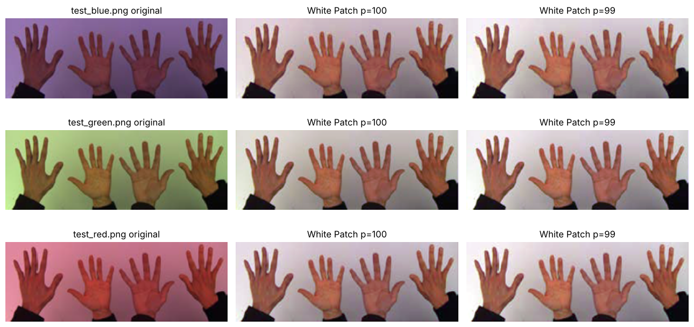
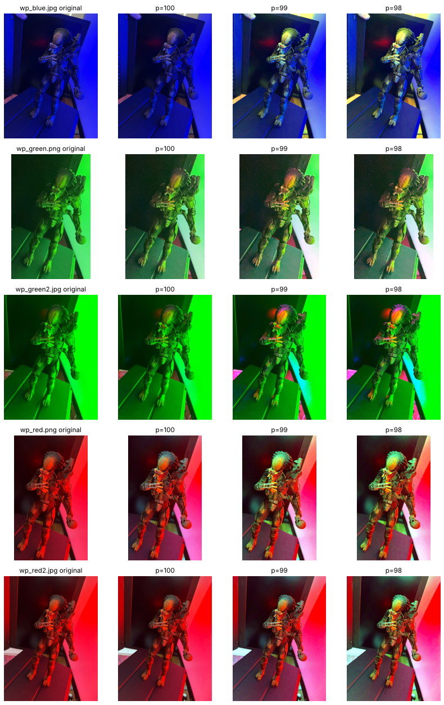
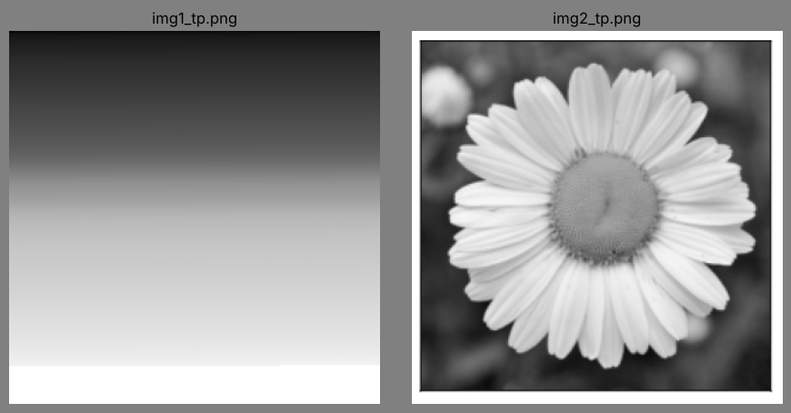
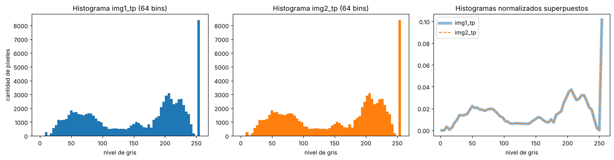

# Visión por Computadora I

Trabajos prácticos de la materia Visión por Computadora I del Posgrado en Inteligencia Artificial de la Facultad de Ingeniería de la Universidad de Buenos Aires (FIUBA).

Docente: Ing. Maxim Dorogov

Integrantes del grupo:

* Florencia Lucca
* Carlos Lugones
* Mariano Reimondez

Material de la materia: [FIUBA-Posgrado-Inteligencia-Artificial/vision_computadora_I](https://github.com/FIUBA-Posgrado-Inteligencia-Artificial/vision_computadora_I)

## Contenido

* [TP1](TP1/): White Patch e histogramas en escala de grises.
* TP2: pendiente.
* TP3: pendiente.

## Cómo ejecutar los notebooks

Requisitos: Python 3 con NumPy, OpenCV, Matplotlib y Jupyter.

```bash
git clone https://github.com/lugo2012cl-prog/CVI-IA.git
cd CVI-IA
python3 -m venv .venv
source .venv/bin/activate          # en Windows: .venv\Scripts\activate
pip install -r requirements.txt
cd TP1
jupyter notebook TP1_Vision_por_Computadora_I.ipynb
```

Cada notebook lee las imágenes con rutas relativas a su propia carpeta, por lo que debe abrirse desde ella (en el ejemplo, desde `TP1`). Las imágenes necesarias están incluidas en el repositorio y no hace falta descargar nada más.

El notebook del TP1 se ejecutó completo, de la primera a la última celda, con Python 3.13, NumPy 2.5, OpenCV 5.0 y Matplotlib 3.11. Es la combinación con la que se probó, no un requisito: `requirements.txt` no fija versiones.


## TP1. White Patch e histogramas

Notebook: [TP1/TP1_Vision_por_Computadora_I.ipynb](TP1/TP1_Vision_por_Computadora_I.ipynb)

### Consigna

Parte 1 (imágenes en `white_patch/`)

1. Implementar el algoritmo White Patch para librarnos de las diferencias de color de iluminación.
2. Mostrar los resultados obtenidos y analizar las posibles fallas (si es que las hay) en el caso de White Patch.

Parte 2

1. Para las imágenes `img1_tp.png` y `img2_tp.png`, leerlas con OpenCV en escala de grises y visualizarlas.
2. Elegir el número de bins que se crea conveniente y graficar su histograma, comparar los histogramas entre sí. Explicar lo que se observa. Si tuviera que entrenar un modelo de clasificación o detección de imágenes, ¿considera que puede ser de utilidad tomar como features a los histogramas?

### Estructura

```
TP1/
    TP1_Vision_por_Computadora_I.ipynb    notebook con el código, los resultados y el análisis
    imagenes/
        white_patch/                      8 imágenes de la Parte 1 (test_* y wp_*)
        img1_tp.png                       imágenes de la Parte 2
        img2_tp.png
    figuras/                              figuras generadas por el notebook
```

Las imágenes provienen de la carpeta `Material_TPs/TP1` del repositorio de la materia.

### Parte 1. White Patch

El algoritmo supone que la superficie más brillante de la escena es blanca, o al menos acromática, y que la iluminación es una sola y aproximadamente uniforme. Reescala cada canal para que su máximo pase a 255, con un factor 255 / máximo distinto para R, G y B. Como variante robusta, el máximo se reemplaza por un percentil alto (99 o 98), de modo que unos pocos píxeles saturados no definan la referencia. Esto funciona mientras la fracción saturada del canal sea menor que la cola que descarta el percentil (1 % con p=99, 2 % con p=98).

En las imágenes `test_*` el algoritmo compensa la dominante de color ya con el máximo: ningún canal está saturado, el tinte desaparece y las tres imágenes, tomadas con luz azul, verde y roja, quedan con medias por canal casi iguales. Eso muestra que la corrección es consistente entre iluminantes; sin una toma con luz neutra no se puede afirmar que recupere los colores reales.



En las imágenes `wp_*`, con luces de color intensas, aparecen las fallas:

* Canales saturados: en `wp_blue.jpg` los tres canales llegan a 255, los factores valen 1 y la imagen no cambia. Con el percentil 99 la corrección vuelve a funcionar. En las imágenes rojas y en `wp_green2.jpg` el canal dominante tiene entre 5 % y 9 % de píxeles saturados, más que la cola que descarta el percentil, de modo que incluso sus percentiles 99 y 98 valen 255 y la corrección sale solo de los otros dos canales.
* No hay un blanco en la escena: lo más brillante es la pared iluminada por la lámpara de color, por lo que la corrección es parcial.
* Canales casi sin señal: con luz casi monocromática, amplificar los canales débiles agrega ruido, y donde el canal dominante estaba saturado la proporción entre canales se desplaza, con colores espurios como resultado.
* Costo del percentil: cuanto más bajo, más píxeles terminan saturados y esa información se pierde. En `wp_blue.jpg` se pasa de 0,5 % a 2,5 % con p=99 y a 5,9 % con p=98.
* Corrección global: un único factor por canal supone una sola fuente de luz uniforme en toda la imagen.



### Parte 2. Histogramas

`img1_tp.png` es un degradé vertical que termina en una franja blanca, y `img2_tp.png` una margarita rodeada por un marco blanco. Ese marco no se distingue sobre una página blanca, por eso las imágenes se muestran sobre fondo gris. Se usaron 64 bins: con 256 la curva queda irregular y con 16 el pico en 255 se mezcla con los valores de los pétalos.





Los dos histogramas son idénticos (correlación 1) porque las dos imágenes tienen exactamente el mismo conjunto de valores de píxel, dispuestos de otra manera. En la margarita, el modo oscuro se asocia visualmente con el fondo, el pico cercano a 150 con el disco central y el modo claro con los pétalos. El pico en 255 (10 % de los píxeles) corresponde al marco blanco: los pétalos no superan 247, no hay valores entre 248 y 254, y los 8400 píxeles en 255 están todos en el borde de la imagen.

Como feature aislada, el histograma no alcanza para clasificar o detectar: descarta la información espacial. En este trabajo observamos que un degradé y una flor producen el mismo vector, mientras que el contraste local, que sí depende de la disposición de los píxeles, las separa claramente (30 contra 192). Además, el histograma cambia con la iluminación aunque el contenido no cambie: es la situación inversa, la misma escena puede dar histogramas distintos. A favor, el histograma es invariante a las transformaciones que solo reordenan píxeles (espejados, rotaciones de 90° y 180°) y aproximadamente invariante a rotaciones arbitrarias, traslaciones y cambios de escala, que interpolan o recortan; normalizado no depende del número de píxeles y es barato de calcular, por lo que sirve como feature complementaria o cuando las clases se distinguen por su distribución de intensidades. Calculado por regiones recupera parte de la información espacial.

En síntesis, `img1` e `img2` contienen la misma información, pero distribuida de manera diferente. El histograma conserva la información y descarta la distribución, y es justamente en la distribución donde está lo que hace que una imagen sea una flor y la otra un degradé.

### Referencias

* Szeliski, R. (2022). Computer Vision: Algorithms and Applications (2.ª ed.). Springer.
* Forsyth, D. A. y Ponce, J. (2012). Computer Vision: A Modern Approach (2.ª ed.). Pearson.
* Dalal, N. y Triggs, B. (2005). Histograms of Oriented Gradients for Human Detection. En IEEE Conference on Computer Vision and Pattern Recognition (CVPR).
* Documentación de OpenCV: https://docs.opencv.org
